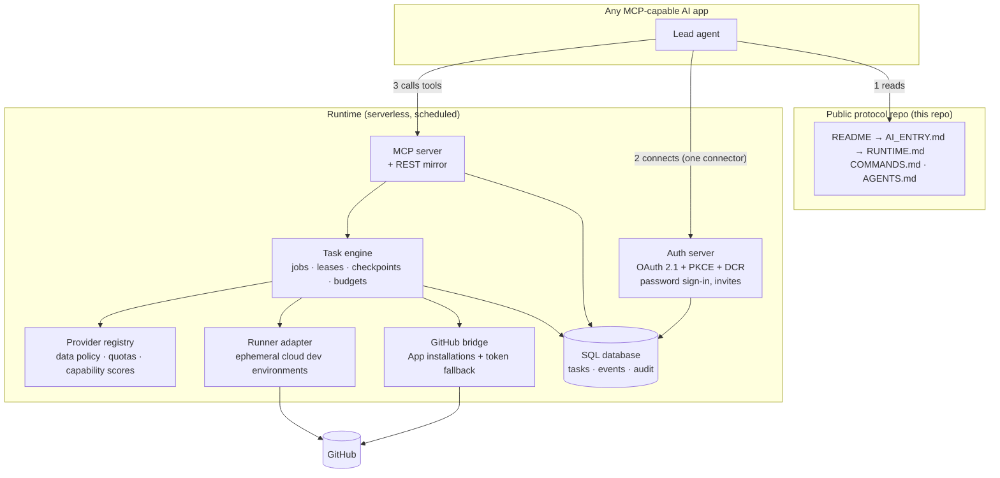
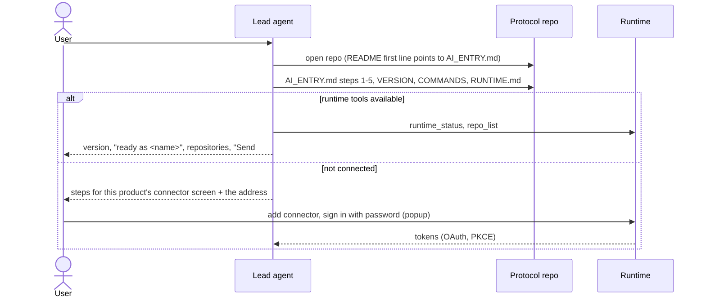
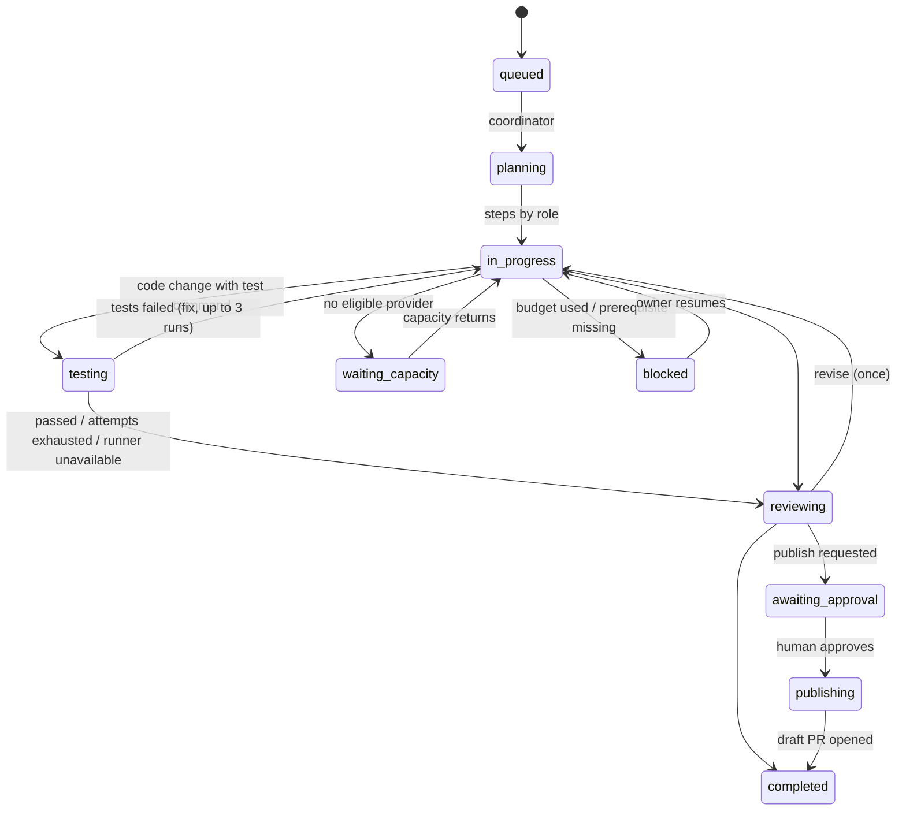

# Architecture

This document describes the design of Agent Protocols at the level needed to review it: components, data flows, the security model, failure handling and the trade-offs behind them. Vendor and provider specifics of the private runtime are left out on purpose; they are interchangeable by design.

## 1. Goals and constraints

| Goal | Constraint that shaped the design |
|---|---|
| Work from **any** AI chat app | The app's own agent must be able to start from one short text command, with no plugin and no prior knowledge. |
| Keep working when chats close | Execution state cannot live in a chat or a long-running process. |
| Cost **$0** to operate | Only free tiers. No payment methods on file, no paid fallback, and limits respected rather than evaded. |
| Safe autonomy in real repositories | Every repository write is approval-gated, scoped, auditable and reversible. |
| Replaceable parts | Models, providers and the runner can change without changing the protocol. |

## 2. Components

- **Protocol repository.** The contract every agent follows: commands, safety rules, continuity, and the breadcrumb path to the runtime. It is versioned, and agents re-read it at every `#init`.
- **Auth server.** Standard OAuth 2.1 with PKCE (S256), dynamic client registration and audience-bound tokens, so any compliant AI app can connect without pre-registration. People sign in with a per-person access password in the popup the app opens.
- **MCP server.** 24 tools: status, repositories, projects, tasks, events, artifacts, approvals, access management and owner operations. Mutating tools require idempotency keys. A REST mirror serves agents without MCP.
- **Task engine.** Jobs (plan, step, test, review, revise, publish) are stored in the database. A scheduled tick leases and runs them. Each job is retried with exponential backoff, and a crashed lease is reclaimed after it expires.
- **Provider registry.** Free model providers, each with:
  - a **data policy** (`private_ok` or `public_only`);
  - a daily cap and rate-limit memory;
  - allowed roles;
  - an offline capability score.
- **GitHub bridge.** Per-owner installation tokens from a GitHub App, so one runtime can serve repositories across several accounts. A fine-grained personal token is the fallback.
- **Runner adapter.** Creates a temporary cloud development environment on a scratch branch, runs the project's test command there, and receives the result through a one-time callback.

## 3. The breadcrumb bootstrap

The hardest constraint is "any agent, one command". Agents differ in what they can do, so the bootstrap degrades gracefully:

- The runtime address lives **only** in the protocol, so moving the runtime means editing one file.
- Agents that cannot browse GitHub can call `protocol_get` once connected.
- Products that cannot add custom connectors are reported plainly. They are never worked around.

## 4. Task lifecycle

**Properties enforced in code, not left to prompts:**
- **A budget that can't be exceeded.** Every model call is reserved against the task's call budget with one atomic update before it runs. Calls refused for lack of capacity are refunded.
- **Reviewer independence.** The reviewer is chosen to differ from the providers that produced the work wherever the data policy allows; for private work, at minimum a different model family.
- **Exact publishing.** Publish uses the approved file list, re-checks path rules and commits atomically to `agent/<task>`. It never writes the default branch, and a retry never duplicates a commit.
- **Honest test reporting.** The PR description reports the test result exactly: passed, still failing, or not run and why.

## 5. Security model

| Threat | Control |
|---|---|
| Stolen or replayed tokens | Opaque tokens stored as hashes; audience-bound to the MCP resource; short-lived access with rotating refresh; revocation on password reset or member removal |
| Cross-site sign-in abuse | PKCE S256, same-browser cookie plus form token on consent, origin checks, exact redirect-URI matching, a CSP that allows only the client's registered redirect |
| Password guessing | Runtime-generated passwords (about 120 bits) shown once and stored as hashes; per-address lockout after repeated failures |
| Over-broad repository access | Per-person repository grants; the owner alone manages access and runtime settings; per-project path allow and deny lists; workflow and secret-like paths always refused |
| Private code leaking to the wrong provider | Data-class routing: private tasks are only ever offered to `private_ok` providers, and this can't be changed from a chat |
| Prompt injection via repo content, logs or model output | Treated as untrusted data; models only produce artifacts and file proposals; every write goes through approval and server-side validation |
| Runaway cost or quota abuse | Free tiers only, no payment methods on file; daily provider caps; per-task budgets; member daily task limits; registration caps |
| Secret exposure | No secrets in chat, prompts, logs or repositories; one-time invite and runner tokens stored as hashes and never echoed in replayed responses |

## 6. Failure handling

- **Provider limits.** On a rate-limit response the call fails over immediately to the next eligible provider, up to three. If none has capacity, the job is deferred with backoff and the task shows `waiting_capacity`.
- **Crashes and restarts.** Leases expire and jobs are re-run. Every handler is idempotent: steps are keyed by task and index, and commits are compared by tree.
- **Runner silence.** A run with no result after 30 minutes counts as failed. Environments and scratch branches are deleted after every run.
- **Housekeeping.** A daily job removes expired sign-in data and abandoned registrations; task history is kept.

## 7. Trade-offs and known limits

- **Free models are weaker than frontier models.** The design compensates with:
  - narrow roles and bounded tasks;
  - real tests and an independent review;
  - human approval.

  It also assumes the **Lead** handles the hard reasoning. It is a force multiplier, not a replacement for a capable Lead.
- **Free quotas bound throughput.** Work queues and resumes; it doesn't go faster by spending.
- **Connector support varies by product and plan.** That is outside the project's control, so it's documented rather than worked around.
- **Execution is pull-based** (a scheduled tick), not event-driven: simple and cheap, at the cost of up to a minute of latency.
- **Verification status** is tracked publicly in the README. Features are not called "done" until they have been verified live.
